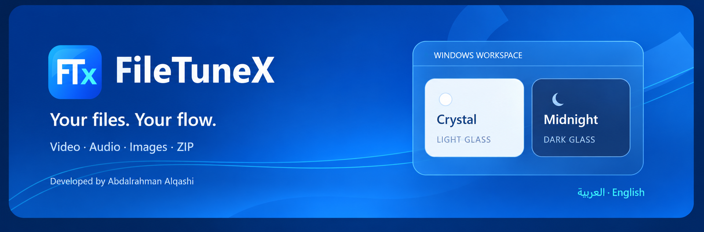
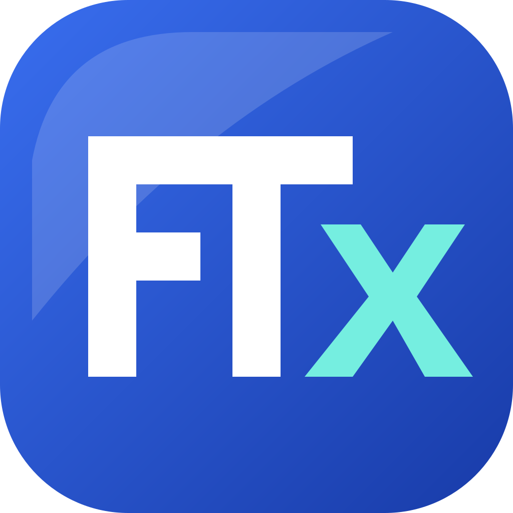
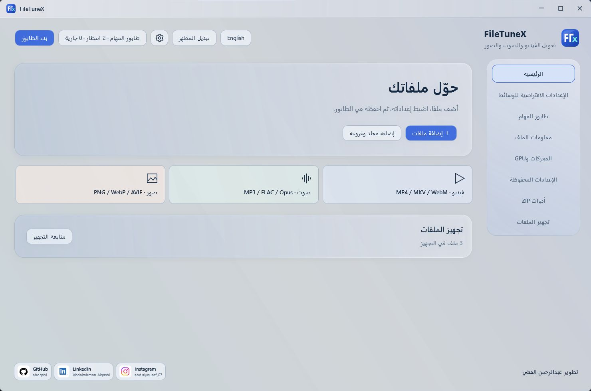
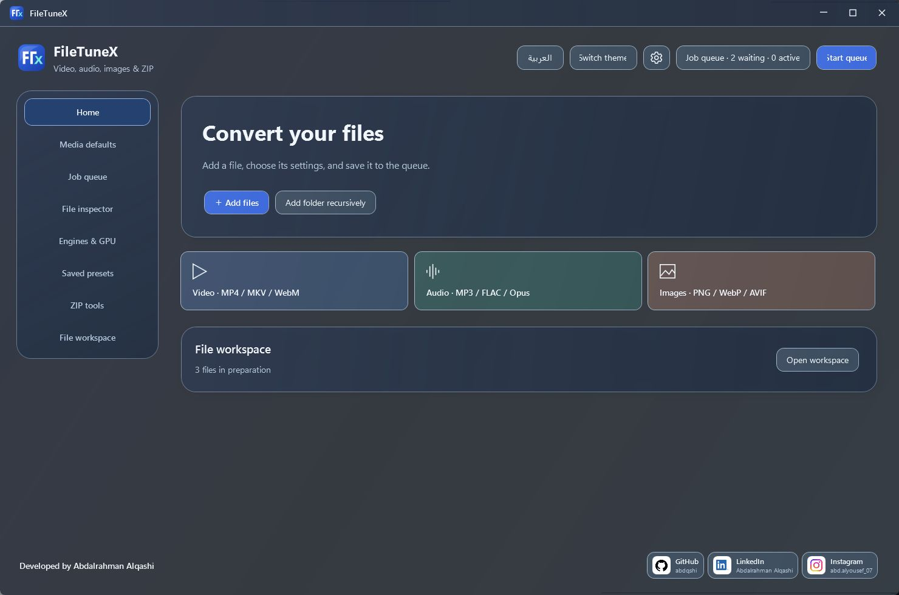
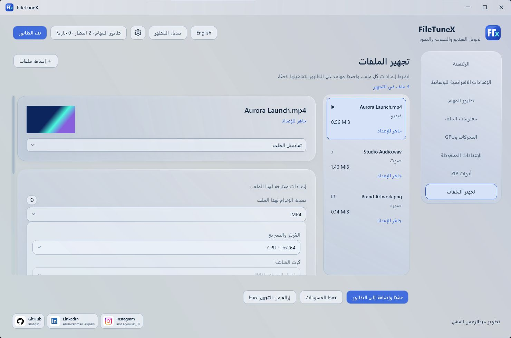
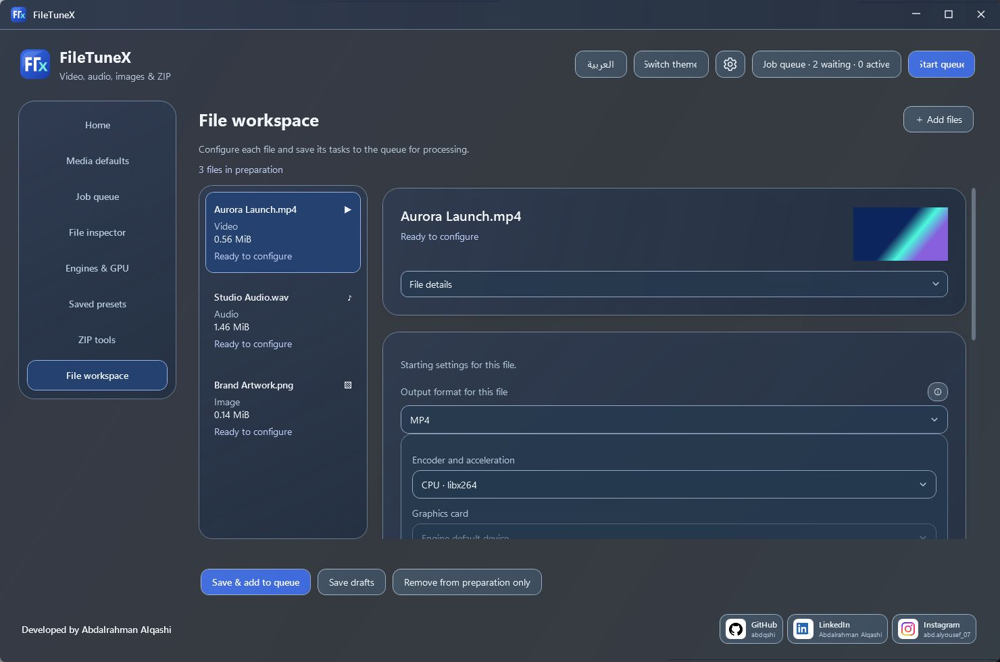
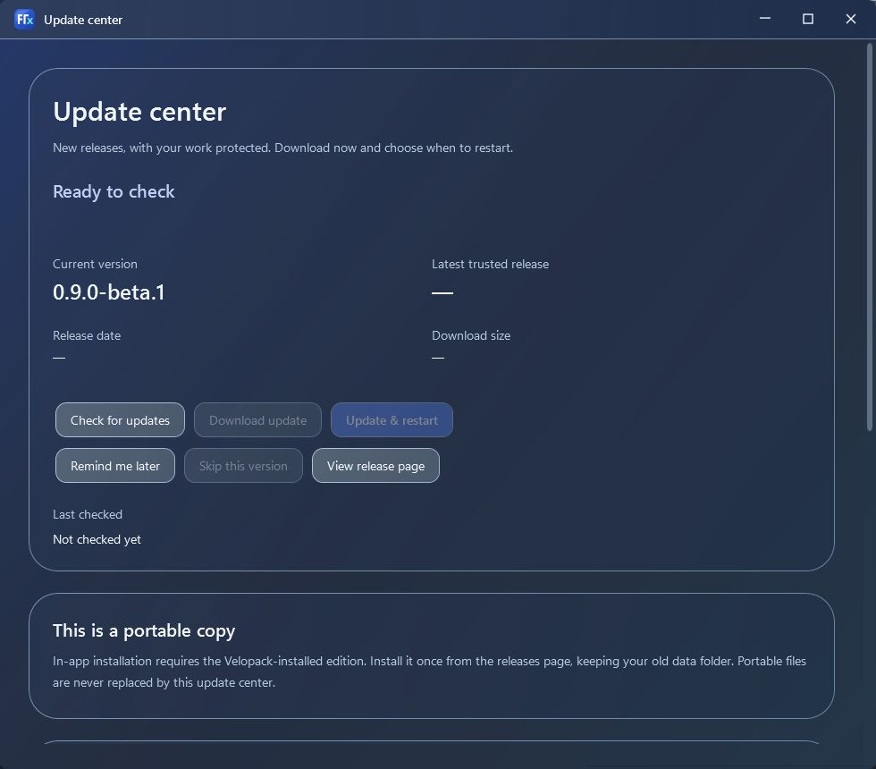

<h1 align="center">FTX</h1>

<strong>FileTuneX</strong> · Your files. Your flow. · ملفاتك، على مزاجك.

<strong>ملفاتك، على مزاجك. · Your files. Your flow.</strong> تطوير عبدالرحمن القشي · Developed by Abdalrahman Alqashi

Windows x64 · العربية / English · Light & Dark

A local Windows workspace for video, audio, images and ZIP. Prepare every file separately, save tasks, then run the queue when you are ready.

مساحة عمل لتحويل الفيديو والصوت والصور وZIP. اضبط كل ملف لحاله، احفظ المهام، وابدأ الطابور وقت ما تكون جاهز.

Latest preview: **0.9.0 Beta 1**, with a Windows installer and a bilingual Update Center.

آخر نسخة تجريبية: **0.9.0 Beta 1**، مع مثبّت ومركز تحديثات بالعربية والإنجليزية.

**[↓ Windows installer / تنزيل مثبّت ويندوز](https://github.com/abdqshi/FileTuneX/releases/download/v0.9.0-beta.1/AbdalrahmanAlqashi.FileTuneX-beta-Setup.exe)** · [All files / جميع الملفات](https://github.com/abdqshi/FileTuneX/releases/tag/v0.9.0-beta.1) · [Setup / التشغيل](docs/INSTALL_0.9.md) · [Gallery / المعرض](docs/GALLERY.md) · [For creators / لصنّاع المحتوى](docs/CREATORS.md)

<table><tr><th>Crystal · العربية</th><th>Midnight · English</th></tr><tr><td></td><td></td></tr></table>

| Your work / شغلك | FileTuneX |
|---|---|
| Video, audio & images / الوسائط | 18 output profiles; per-file codecs, resize and trimming. |
| Queue / الطابور | Save tasks first; selection, ordering, cancellation and retry. |
| Hardware / التسريع | GPU encoder checks and device selection where supported. |
| ZIP | Create, inspect, verify, extract and optional AES-256 password protection. |
| File details / معلومات الملف | Structured video/audio/container cards. |
| Appearance / المظهر | Eight presets, detailed glass controls, reduced motion, Arabic RTL and English. |

<table><tr><td></td><td></td></tr></table>

.NET is included in Windows release packages. ZIP works directly; media conversion needs separately supplied FFmpeg/FFprobe. Hardware support depends on the device, driver and codec. Original input files are preserved. Current packages have no Authenticode publisher signature.

.NET مرفق. ZIP يعمل مباشرة، وتحويل الوسائط يحتاج FFmpeg وFFprobe منفصلين. دعم التسريع يعتمد على جهازك وتعريفاته. الملفات الأصلية محفوظة. لا توجد شهادة ناشر Windows حاليًا.

## Updates / التحديثات

The 0.9 Beta adds a bilingual Update Center, signed full-package verification and queue-safe restart consent. Old ZIPs need the installer once. A real installed upgrade passed against a local signed feed; a live GitHub installed upgrade and automatic rollback are not yet qualified. Beta is explicit opt-in and excluded from Stable. [Update help / المساعدة](docs/UPDATE_TROUBLESHOOTING.md).

Download integrity and the public update feed have been checked. [Test scope and limits / ما اختُبر وحدوده](docs/UPDATE_VERIFICATION.md).

## الحقوق والترخيص / Rights and licensing

**© 2026 Abdalrahman Alqashi / عبدالرحمن القشي. جميع الحقوق محفوظة وفق التراخيص المرفقة.**

Use and distribution are governed by the terms included with each release. Third-party components keep their own licenses. [License details / الترخيص](docs/LICENSING.md).

[GitHub](https://github.com/abdqshi) · [LinkedIn](https://www.linkedin.com/in/abdalrahman-alqashi/) · [Instagram](https://www.instagram.com/abd.alyousef_07/)
