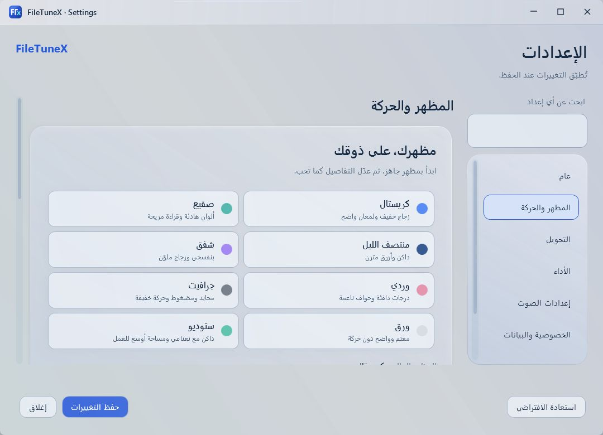
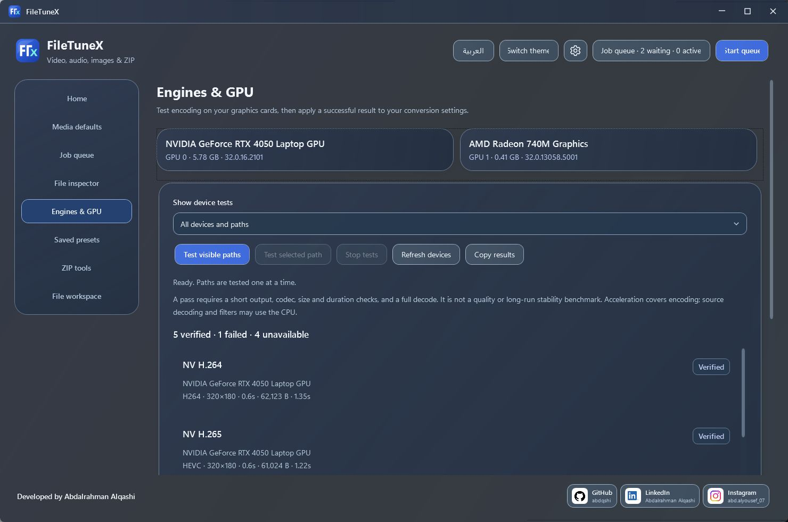
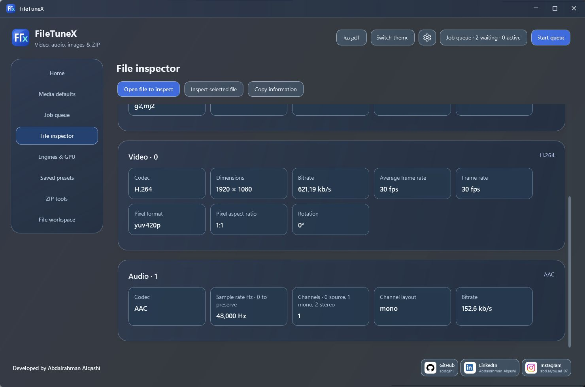

# معرض الواجهة / Interface gallery

[الرئيسية / Home](../README.md) · [التثبيت / Install](INSTALL_0.9.md)

Actual FileTuneX captures with generated sample files. Layout details can vary with the release, theme and Windows settings. GPU results apply to the pictured device only.

لقطات فعلية بملفات تجريبية مولّدة. قد تختلف تفاصيل الواجهة حسب النسخة والمظهر وإعدادات Windows. نتائج GPU تخص الجهاز الظاهر فقط.

## Crystal · العربية

## Midnight · English

## تجهيز الملفات / File workspace

## المظهر / Appearance

## GPU

## معلومات الملف / File information

## التحديثات / Updates

